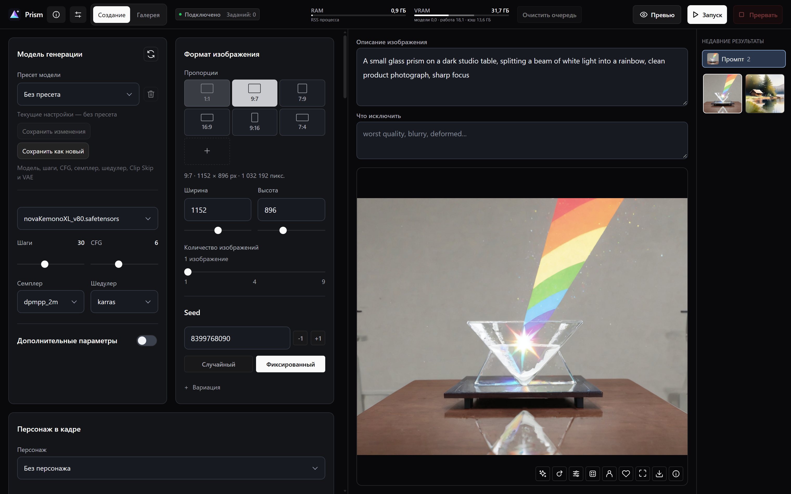

# Prism

**English** · [Русский](README.ru.md)

Generate images locally through ComfyUI. Build prompts with LoRA presets, run batches, and reuse the settings behind images in your gallery.

**Windows 10/11 x64 · ComfyUI · SDXL, Pony and Illustrious**

[Download Prism v0.2.0](https://github.com/VoyagerVPN/Prism/releases/tag/v0.2.0)

## Quick start

1. Install [Git for Windows](https://git-scm.com/download/win) and the [Visual C++ Redistributable x64](https://aka.ms/vc14/vc_redist.x64.exe).
2. Extract the release ZIP into a permanent local folder and run `Setup.bat`. Choose a language and select **Install** or connect an existing ComfyUI installation. For a first install without a model, choose SDXL Base.
3. In Prism, load the included example and start generation. Run `Prism.bat` for later sessions and keep its launcher window open while jobs are running.

## Features

- Save characters, outfits and LoRA presets. Export and import character cards.
- Generate batches of 1, 4 or 9 images with a fixed or changing seed.
- Filter gallery images by tags or characters, reuse their settings or rerun a saved workflow.

## Requirements

Windows 10/11 x64 and at least 16 GB of RAM (32 GB recommended). The default NVIDIA setup requires 8 GB of VRAM and a driver compatible with CUDA 12.8. Setup also offers a slower CPU mode.

See the [setup and troubleshooting guide (Russian)](docs/setup.ru.md) and [technical documentation](app/README.md).
