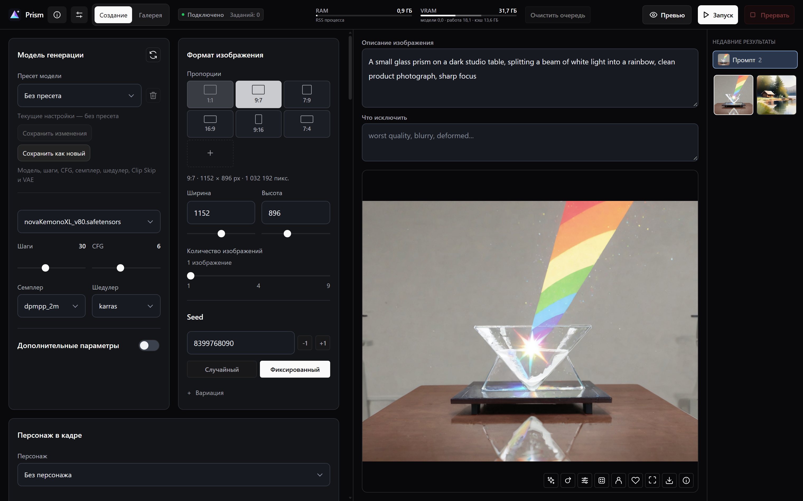

# Prism


[English](README.md) · **Русский**

Генерируйте изображения на своём компьютере через ComfyUI. Собирайте промпты с LoRA, запускайте серии и возвращайтесь к настройкам из галереи.

**Windows 10/11 x64 · ComfyUI · SDXL, Pony и Illustrious**

[Скачать Prism v0.2.0](https://github.com/VoyagerVPN/Prism/releases/tag/v0.2.0)

## Быстрый старт

1. Установите [Git for Windows](https://git-scm.com/download/win) и [Visual C++ Redistributable x64](https://aka.ms/vc14/vc_redist.x64.exe).
2. Распакуйте ZIP релиза в постоянную папку и откройте `Setup.bat`. Выберите язык и нажмите **Установить** или подключите существующий ComfyUI. Если своей модели пока нет, выберите SDXL Base.
3. В Prism нажмите **Подготовить пример**, затем **Запуск**. Для следующих сеансов открывайте `Prism.bat` и держите окно запуска открытым, пока выполняются задания.

Язык можно изменить в установщике или в настройках Prism.



## Возможности

- Сохраняйте персонажей, варианты одежды и наборы LoRA. Переносите карточки персонажей между установками.
- Генерируйте серии по 1, 4 или 9 кадров с фиксированным или меняющимся seed.
- Фильтруйте галерею по тегам и персонажам, возвращайте настройки или повторяйте сохранённую генерацию.

## Требования

Windows 10/11 x64 и от 16 ГБ оперативной памяти, рекомендуется 32 ГБ. Для установки на NVIDIA нужны от 8 ГБ видеопамяти и драйвер с поддержкой CUDA 12.8. В установщике есть более медленный режим для CPU.

## Подключение существующего ComfyUI

Остановите ComfyUI, запустите `Setup.bat` и укажите папку ComfyUI или корень ComfyUI Portable. Подтвердите путь к Python и нажмите **Сохранить**. Затем запускайте `Prism.bat`. Пути сохраняются в `app/prism.local.json`.

## Обновление и резервная копия

Остановите backend. Сохраните `app/data`, `app/prism.local.json`, свои модели, а также `input`, `output` и `user` ComfyUI в резервную папку. Настройки браузера привязаны к адресу панели.

Если старая установка использует `app/prism.json`, перед обновлением скопируйте его в `app/prism.local.json`. Если локальный файл уже есть, он содержит действующие настройки.

Обновление Prism из Git:

```powershell
git pull --ff-only
```

Сначала сохраните свои изменения исходников, если они есть. Затем запустите `Prism.bat`. Если новая версия меняет зависимости установки, повторите Setup с прежним устройством. Для установки из ZIP обновляйте исходники с сохранением `.runtime`, `.cache`, `app/data` и `app/prism.local.json`. npm install для запуска не нужен.

Для внешнего ComfyUI: `Check-Update.bat` проверяет стабильный релиз, `Update-ComfyUI.bat` устанавливает его при остановленном backend. Локальные изменения ComfyUI блокируют обновление. В `app/.cache/updates/<дата>` сохраняются исходники, ревизия, список пакетов, пользовательские файлы и конфигурация. Torch/CUDA защищены текущими версиями. Custom nodes не обновляются. Совместимость будущего ComfyUI с дополнительными моделями проверяется отдельно.

Если обновление оборвалось, восстановите среду до удаления маркера неполного обновления. При остановленном backend верните ревизию из `revision.txt` командой `git -C <каталог-ComfyUI> checkout --detach <ревизия>`, восстановите пакеты настроенным Python через `-m pip install -r <backup>/packages.txt` и выполните `-m pip check`. Затем восстановите нужные файлы `user`, конфиг и `prism-install.json` из той же копии, если он есть. Копия содержит список версий, а не полный образ Python; для восстановления может понадобиться сеть. Подробности: [app/README.md](../app/README.md).

## Диагностика

| Сообщение или симптом | Действие |
| --- | --- |
| PRISM_GIT / PRISM_VC_RUNTIME | Установите указанную системную предпосылку. |
| PRISM_DISK | Выберите диск с нужным запасом места. Скрипт не очищает глобальные кэши. |
| PRISM_EXISTING_CONFIG / PRISM_FOREIGN_RUNTIME | Используйте новую папку либо подключите существующий ComfyUI вручную. |
| Ошибка загрузки / TLS / 403 | Проверьте доступ к указанному официальному серверу. Скрипт не отключает TLS и не заменяет источник зеркалом. |
| CUDA недоступна / import torch | Проверьте драйвер NVIDIA, VC++ x64 и поддержку видеокарты. CPU выбирается явно в отдельной папке. |
| PRISM_SETUP_INCOMPLETE | Повторите Setup с прежним устройством и прочитайте последнюю ошибку. |
| Порт занят / PRISM_PORT | Остановите эту установку либо выберите свободный `-Port`. Чужой процесс не завершается. |
| Нет модели | Проверьте окно первого запуска и наличие полного checkpoint. Обновите список после импорта. |
| Не хватает VRAM | Начните с одного кадра 512 × 512 без обработок; освободите GPU-память других программ. |
| ComfyUI завершился | Прочитайте `app/.cache/runtime/server.stderr.log` и `server.stdout.log`. Ошибка импорта custom node означает, что Prism ещё не готов. |

Запущенный сервер ещё не подтверждает генерацию: пройдите пример до изображения в галерее. Для сообщения об ошибке укажите версию Prism (`git rev-parse HEAD`), устройство и драйвер, параметры Setup и последний этап журнала. Не прикладывайте токены и личные изображения.

[Техническая документация](app/README.md).
