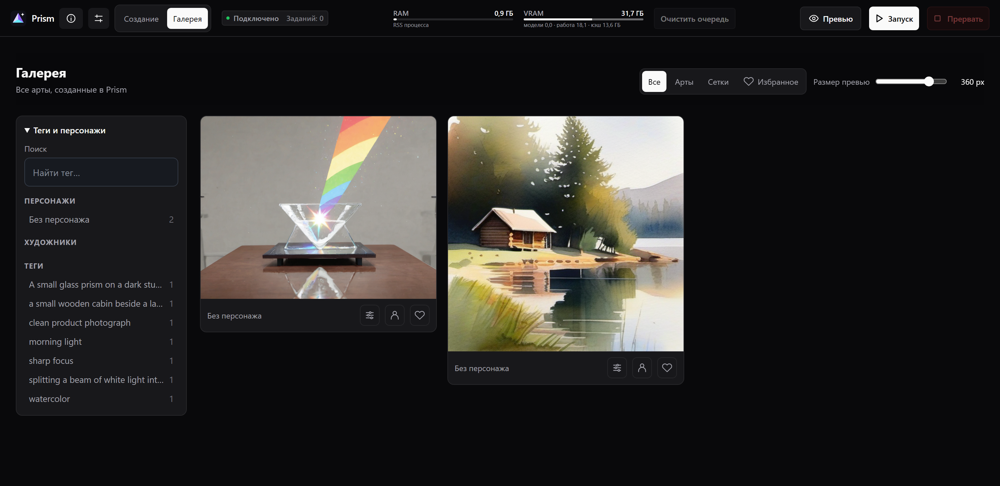

# Prism


[English](README.md) · **Русский**

Генерируйте изображения на своём компьютере через ComfyUI. Собирайте промпты с LoRA, запускайте серии и возвращайтесь к настройкам из галереи.

**Windows 10/11 x64 · ComfyUI · SDXL, Pony и Illustrious**

[Скачать Prism v0.2.0](https://github.com/VoyagerVPN/Prism/releases/tag/v0.2.0)

## Быстрый старт

1. Установите [Git for Windows](https://git-scm.com/download/win) и [Microsoft Visual C++ Redistributable x64](https://aka.ms/vc14/vc_redist.x64.exe), если их ещё нет.
2. На странице релиза скачайте `Prism-Windows-v0.2.0.zip`, распакуйте его и откройте `Setup.bat`. Выберите язык и нажмите **Установить**. Если у вас нет своей модели, выберите **1 — SDXL Base** и подтвердите загрузку.
3. Когда Prism откроется в браузере, нажмите **Подготовить пример**, затем **Запуск**. Кадр появится в рабочей области и в галерее. Для следующих запусков открывайте `Prism.bat`.

Если ComfyUI уже установлен, подключите его в том же окне `Setup.bat`. По умолчанию новая установка использует NVIDIA. Язык можно изменить в настройках Prism.


## Возможности

- **Персонажи и LoRA.** Храните варианты внешности и одежды, подбирайте совместимые LoRA и переносите карточки между установками в формате `.prism`.
- **Серии и пресеты.** Делайте 1, 4 или 9 кадров, сохраняйте сетку и настройки модели. Seed можно зафиксировать или менять между кадрами.
- **Галерея.** Ищите изображения по тегам и персонажам, добавляйте в избранное, возвращайте настройки или повторяйте сохранённую генерацию. Для старых записей без графа точный повтор недоступен.



Prism добавляет браузерную панель `/prism/` к ComfyUI. По вашим настройкам Prism собирает workflow, а ComfyUI выполняет его с выбранной моделью на вашем компьютере. Для начала достаточно полного SDXL checkpoint: Pony и Illustrious используют тот же загрузчик. Anima Aesthetic доступна отдельным рецептом и требует своих весов, энкодера и VAE.

## Требования

- Windows 10/11 x64. Начальный GPU-профиль: NVIDIA от 8 ГБ VRAM с актуальным драйвером для CUDA 12.8. Отдельный CUDA Toolkit не требуется.
- От 16 ГБ RAM, рекомендуется 32 ГБ. Есть отдельный медленный CPU-режим. AMD, Intel GPU, Windows ARM и другие ОС этим установщиком не настраиваются.
- **14 ГиБ свободного места для NVIDIA или 5 ГиБ для CPU** на установку окружения, плюс место под выбранные модели. В чистой установке без моделей окружение вместе с кэшами заняло около 11,3 ГиБ на NVIDIA и 3,6 ГиБ на CPU.
- [Git for Windows](https://git-scm.com/download/win). После установки откройте PowerShell заново, чтобы обновился PATH.
- [Microsoft Visual C++ Redistributable x64](https://aka.ms/vc14/vc_redist.x64.exe), если ещё не установлен.
- Доступ к GitHub, PyPI, download.pytorch.org и Hugging Face.

Python, Node.js, Stability Matrix и заранее установленный ComfyUI не нужны. Веб-интерфейс находится в репозитории и не требует npm-сборки. Anima и дополнительные расширения в начальный профиль не входят.

## Установка с нуля

Выберите постоянную папку на локальном диске, вне другой установки ComfyUI и синхронизации OneDrive. Из распакованного ZIP запустите `Setup.bat` и выберите **Установить**. Если предпочитаете Git, откройте PowerShell в родительском каталоге выбранной папки:

```powershell
git clone https://github.com/VoyagerVPN/Prism.git
cd Prism
powershell.exe -NoProfile -ExecutionPolicy Bypass -File .\Setup.ps1
```

Консоль покажет состав окружения и таблицу моделей. Введите номера нужных моделей через запятую или нажмите Enter, если у вас есть свои веса. После подтверждения Setup установит Python, PyTorch и ComfyUI, скачает выбранные файлы и проверит SHA256. Затем он запустит Prism.

Git нужен и при установке из ZIP, поскольку через него Setup получает ComfyUI. При установке с нуля окно `Setup.bat` передаёт управление установщику `Setup.ps1`. Подтверждение загрузки и ход установки показываются в консоли.

Другие варианты:

```powershell
# Только показать план, без загрузок и установки
powershell.exe -NoProfile -ExecutionPolicy Bypass -File .\Setup.ps1 -Plan

# Заранее согласованные загрузки; установить и пока не запускать
powershell.exe -NoProfile -ExecutionPolicy Bypass -File .\Setup.ps1 -Model SDXL -AcceptDownloads -NoLaunch

# Медленный CPU-режим для компьютера без NVIDIA
powershell.exe -NoProfile -ExecutionPolicy Bypass -File .\Setup.ps1 -Device CPU

# Использовать свою модель и другой свободный порт
powershell.exe -NoProfile -ExecutionPolicy Bypass -File .\Setup.ps1 -Model None -Port 8190
```

`-AcceptDownloads` означает согласие на перечисленные загрузки. Сначала прочитайте условия модели по ссылке в плане. Повторяйте команду с тем же устройством. Переключение CPU/NVIDIA требует отдельной папки, чтобы не смешивать варианты PyTorch. Существующую рабочую среду ComfyUI установщик не перенастраивает.

После установки Real-ESRGAN или Real-ESRGAN Anime можно выбрать их в настройках увеличения. Для запуска из командной строки есть параметры `-Upscaler` и `-AnimeUpscaler`.

## Первое изображение

После установки запускайте `Prism.bat`. Окно запуска показывает журнал ComfyUI и должно оставаться открытым. Закрытие окна или Ctrl+C завершает backend и прерывает незаконченные задания. `Stop-ComfyUI.bat` останавливает backend при пустой очереди.

Панель по умолчанию: [http://127.0.0.1:8188/prism/](http://127.0.0.1:8188/prism/). Штатный ComfyUI находится в корне того же адреса. При другом порте используйте адрес лончера. Свежая установка доступна только с локального компьютера.

1. В окне «Первый запуск Prism» проверьте backend и список моделей. Его можно снова открыть кнопкой информации рядом с названием Prism.
2. Нажмите «Подготовить пример»: один кадр 512 × 512, 20 шагов, без LoRA и дополнительных обработок.
3. Во вкладке «Создание» проверьте текст и нажмите «Запуск». При первом запуске ComfyUI загружает модель в память.
4. Результат появится в рабочей области и «Галерее». Сохраните его кнопкой скачивания. Оригиналы находятся в `.runtime/ComfyUI/output`.

Если вы пропустили выбор базовой модели, добавьте полный SDXL checkpoint (в том числе Pony или Illustrious) `.safetensors`. Нажмите «Добавить файл модели» в окне первого запуска либо «Добавить» в библиотеке. Для SDXL Base выберите тип checkpoint и базу SDXL, затем обновите список. LoRA, отдельный UNet и модель другого семейства не заменяют полный checkpoint.

[SDXL Base от Stability AI](https://huggingface.co/stabilityai/stable-diffusion-xl-base-1.0) содержит энкодеры и VAE в одном checkpoint. Соблюдайте [лицензию модели](https://huggingface.co/stabilityai/stable-diffusion-xl-base-1.0/blob/main/LICENSE.md). Для других моделей используйте требования и условия их авторов.

## Файлы установки

| Путь относительно Prism | Содержимое |
| --- | --- |
| `.runtime/python`, `.runtime/venv` | Отдельный Python и пакеты этой установки |
| `.runtime/ComfyUI` | ComfyUI этой установки, его input, output и user |
| `.runtime/models/StableDiffusion` | Базовые модели |
| `.runtime/models/RealESRGAN` | Выбранные модели увеличения |
| `.runtime/prism-install.json` | Устройство, версия и состояние установки |
| `.runtime/installed-packages.txt` | Фактические версии Python-пакетов |
| `app/prism.local.json` | Пути, порт и параметры запуска |
| `app/data` | Персонажи, библиотека, пресеты и каталог галереи |
| `.cache`, `app/.cache` | Загрузки, bootstrap, рабочие кэши и журналы |

Python и пакеты устанавливает [uv](https://docs.astral.sh/uv/). ComfyUI загружается из официального Git-репозитория. Скрипт не регистрирует Python в Windows, не меняет PATH и профили оболочки. Лончер подключает Prism через junction `custom_nodes/prism → app`; чужое подключение не заменяется.

Повторный Setup переиспользует своё окружение, проверяет пакеты и сохраняет пользовательские параметры. Для смены порта уже установленной среды измените `port` в `app/prism.local.json` при остановленном backend. Частичная загрузка модели остаётся в `.part` и продолжается при повторе. При неверном SHA256 повреждённый частичный файл удаляется. Существующий файл с другим содержимым сохраняется, установка останавливается. Неполная установка блокирует запуск до исправления и повторного Setup.

Папку после установки оставляйте на месте: venv ссылается на её Python. Для переноса создайте новую установку и перенесите модели и данные. Кэши можно удалить при остановленном backend; `.runtime` содержит само окружение.

## Подключение существующего ComfyUI

1. Остановите ComfyUI и откройте `Setup.bat`. Если мастер нашёл одну подходящую установку, он заполнит поля. В остальных случаях укажите папку с `main.py` или корень ComfyUI Portable.
2. Проверьте путь к Python. Мастер проверит Python из окружения ComfyUI, а затем варианты из PATH, реестра Windows и списка `py`. Если ни один не подошёл, укажите `python.exe` через **Обзор**. Папка моделей по умолчанию берётся из выбранного ComfyUI. Нажмите **Сохранить**.
3. Откройте `Prism.bat`. Мастер сохраняет пути в `app/prism.local.json`. Он проверяет основные зависимости и не устанавливает пакеты.

Для ручной настройки скопируйте `app/prism.example.json` в `app/prism.local.json`. В этом файле можно задать свободный порт и параметры запуска. Относительные пути считаются от `app`. Для своей среды оставьте `managed_install: false`. Пустой `lan_interface` оставляет локальный доступ. Категории моделей перечислены в `app/model-paths.json`.

При запуске Prism лончер создаст junction к `app`, проверит порт и дождётся маршрутов ComfyUI и Prism. Лончер по умолчанию читает только `app/prism.local.json`.

Для Anima, FaceDetailer, ReActor и увеличения нужны дополнительные файлы. См. [техническую документацию](app/README.md). Старые изображения Qwen и редактора остаются в галерее; повтор их рецептов доступен в архивной версии Prism.

## Обновление и резервная копия

Остановите backend. Сохраните `app/data`, `app/prism.local.json`, свои модели, а также `input`, `output` и `user` ComfyUI в резервную папку. Настройки браузера привязаны к адресу панели.

Если старая установка использует `app/prism.json`, перед обновлением скопируйте его в `app/prism.local.json`. Если локальный файл уже есть, он содержит действующие настройки.

Обновление Prism из Git:

```powershell
git pull --ff-only
```

Сначала сохраните свои изменения исходников, если они есть. Затем запустите `Prism.bat`. Если новая версия меняет зависимости установки, повторите Setup с прежним устройством. Для установки из ZIP обновляйте исходники с сохранением `.runtime`, `.cache`, `app/data` и `app/prism.local.json`. npm install для запуска не нужен.

Для внешнего ComfyUI: `Check-Update.bat` проверяет стабильный релиз, `Update-ComfyUI.bat` устанавливает его при остановленном backend. Локальные изменения ComfyUI блокируют обновление. В `app/.cache/updates/<дата>` сохраняются исходники, ревизия, список пакетов, пользовательские файлы и конфигурация. Torch/CUDA защищены текущими версиями. Custom nodes не обновляются. Совместимость будущего ComfyUI с дополнительными моделями проверяется отдельно.

Если обновление оборвалось, восстановите среду до удаления маркера неполного обновления. При остановленном backend верните ревизию из `revision.txt` командой `git -C <каталог-ComfyUI> checkout --detach <ревизия>`, восстановите пакеты настроенным Python через `-m pip install -r <backup>/packages.txt` и выполните `-m pip check`. Затем восстановите нужные файлы `user`, конфиг и `prism-install.json` из той же копии, если он есть. Копия содержит список версий, а не полный образ Python; для восстановления может понадобиться сеть. Подробности: [app/README.md](app/README.md).

## Диагностика

| Сообщение или симптом | Действие |
| --- | --- |
| PRISM_GIT / PRISM_VC_RUNTIME | Установите указанную системную предпосылку. |
| PRISM_DISK | Выберите диск с нужным запасом места. Скрипт не очищает глобальные кэши. |
| PRISM_EXISTING_CONFIG / PRISM_FOREIGN_RUNTIME | Используйте новую папку либо подключите существующий ComfyUI вручную. |
| Ошибка загрузки / TLS / 403 | Проверьте доступ к указанному официальному серверу. Скрипт не отключает TLS и не заменяет источник зеркалом. |
| CUDA недоступна / import torch | Проверьте драйвер NVIDIA, VC++ x64 и поддержку видеокарты. CPU выбирается явно в отдельной папке. |
| PRISM_SETUP_INCOMPLETE | Повторите Setup с прежним устройством и прочитайте последнюю ошибку. |
| Порт занят / PRISM_PORT | Остановите эту установку либо выберите свободный `-Port`. Чужой процесс не завершается. |
| Нет модели | Проверьте окно первого запуска и наличие полного checkpoint. Обновите список после импорта. |
| Не хватает VRAM | Начните с одного кадра 512 × 512 без обработок; освободите GPU-память других программ. |
| ComfyUI завершился | Прочитайте `app/.cache/runtime/server.stderr.log` и `server.stdout.log`. Ошибка импорта custom node означает, что Prism ещё не готов. |

Запущенный сервер ещё не подтверждает генерацию: пройдите пример до изображения в галерее. Для сообщения об ошибке укажите версию Prism (`git rev-parse HEAD`), устройство и драйвер, параметры Setup и последний этап журнала. Не прикладывайте токены и личные изображения.

## Разработка

Исходники панели: `app`. Установщик: `Setup.ps1` и `scripts`. Node.js нужен для JS-тестов; Python-тесты выполняются в среде ComfyUI. См. [команды тестов и проверку чистой установки](docs/INSTALLATION_VERIFICATION.md).
